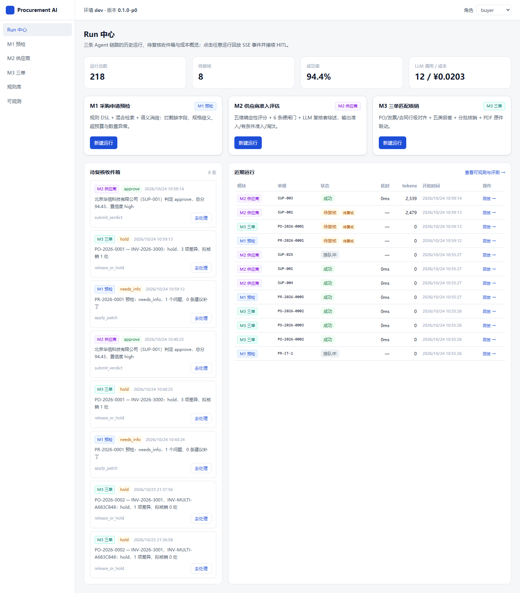
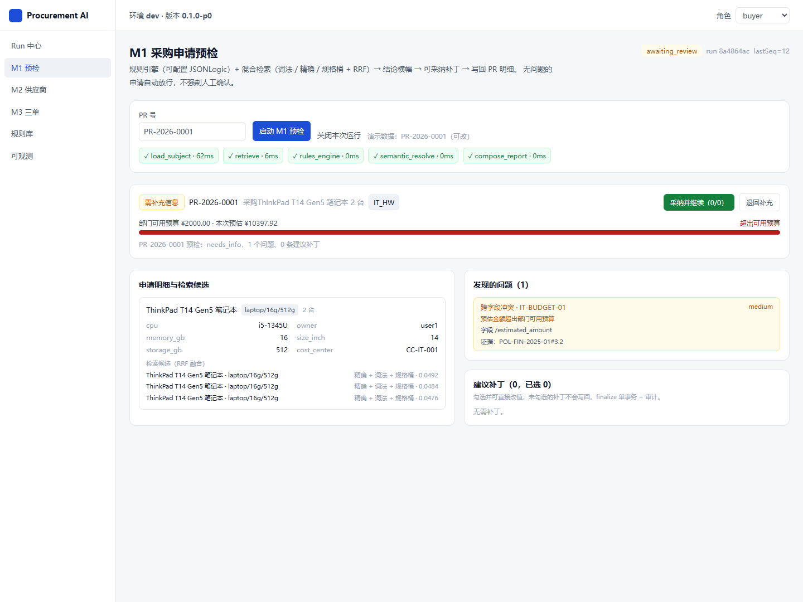
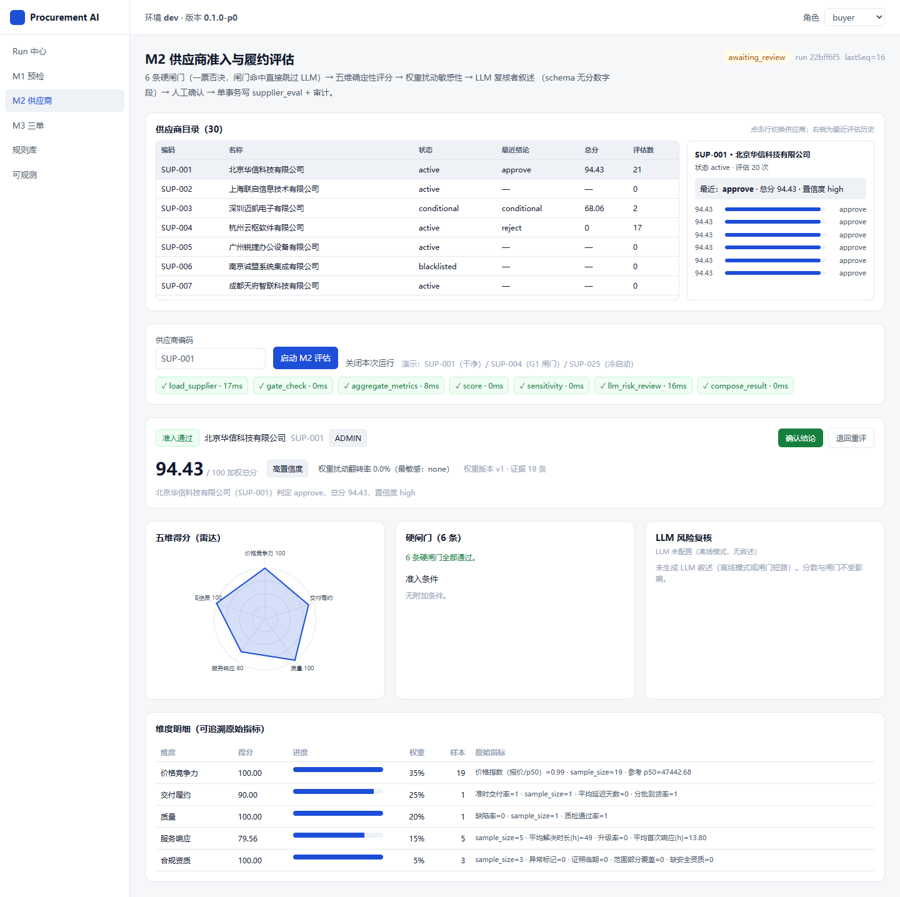
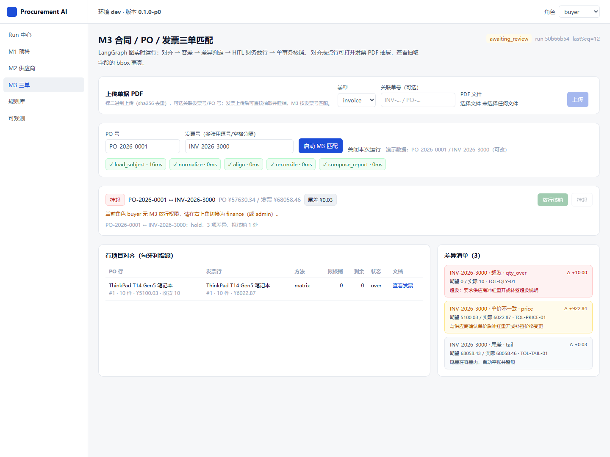
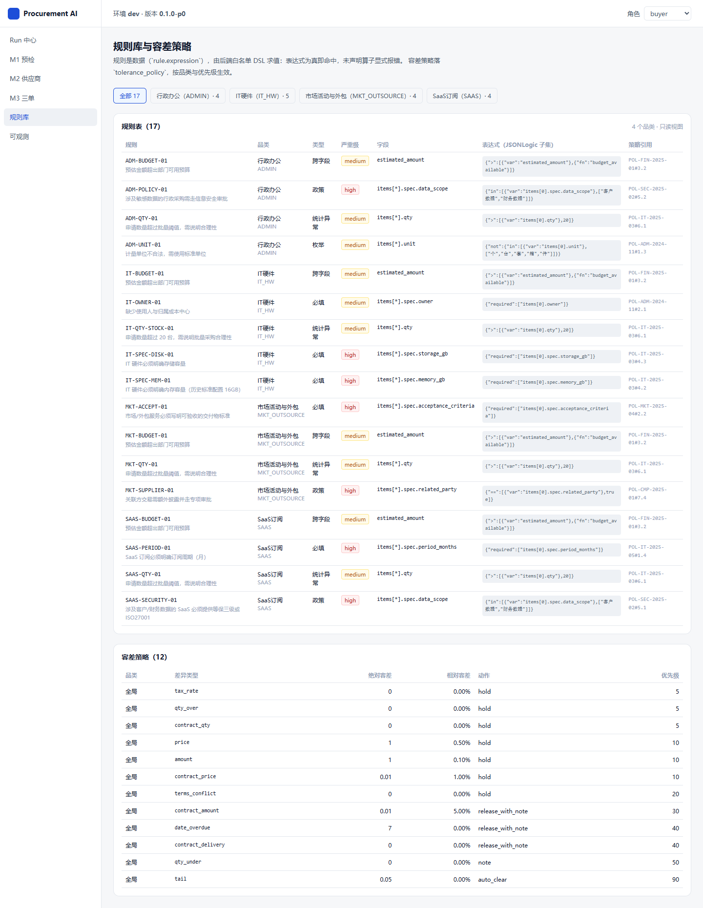
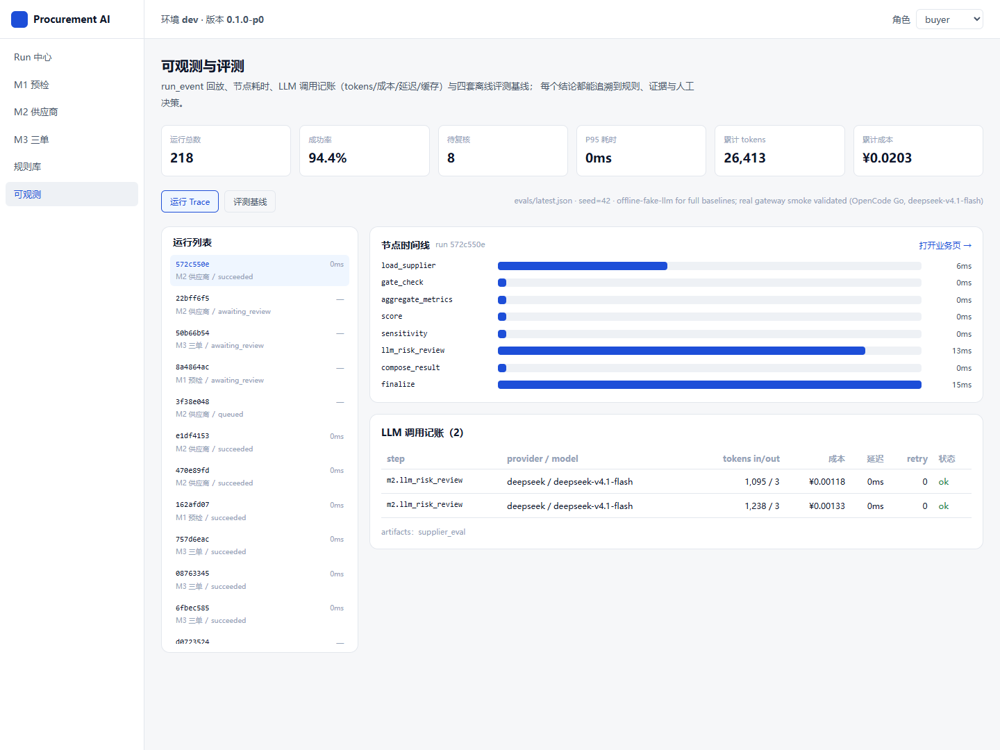

# Procurement AI Agent Workbench

企业通用**间接采购**（IT 软硬件 / SaaS / 行政办公 / 市场活动与外包服务）的 AI 工作台：
在「申请 → 询价 → 准入 → 下单 → 收货 → 结算」链路上，用三个 Agent 卡住**信息不完整**、
**供应商风险**、**三单不一致**三个漏损点，并保留人工复核（HITL）兜底。

- 业务与架构唯一事实来源：**[docs/PROJECT_SPEC.md](docs/PROJECT_SPEC.md)**（v1.14）
- 开发留痕：[PROGRESS](docs/worklog/PROGRESS.md) · [IMPACT_AND_DECISIONS](docs/worklog/IMPACT_AND_DECISIONS.md) · [GOTCHAS](docs/worklog/GOTCHAS.md)
- 评测报告：[EVAL_REPORT.md](docs/EVAL_REPORT.md)（合成数据基线 + 诚实边界）· 部署：[DEPLOYMENT.md](docs/DEPLOYMENT.md) · 设计稿：[design/README.md](design/README.md) · 简历模板：[RESUME_TEMPLATE.md](docs/RESUME_TEMPLATE.md)
- 截图：[docs/screens/](docs/screens/)（Playwright 实拍：Run 中心 / M1 / M2 / M3 / 规则库 / 可观测 / 设计稿）

## 当前状态：W4 演示闭环（6 页全部可用 + 真实模型已验证 + 截图资产）

**已验证**（2026-10-24，seed=42；确定性基线离线，M2 另跑真实网关全量）：

- 后端测试 **128 个（121 passed / 7 skipped**：单测 92/3、DB 集成 29/4）；前端单测 **45 passed**；`tsc` + `vite build` 通过（391.96KB / gzip 117.51KB）。
- 真实 e2e 冒烟全绿：`SMOKE_M1=OK`（needs_info + 补丁写回）、`SMOKE_M2=OK`（SUP-001 approve 94.43）、
  `SMOKE_M3=OK`（overall=hold + PDF 注释 + 财务放行）、`SMOKE_E2E=OK`（SSE/中断/恢复契约）。
- **真实模型已接**：OpenCode Go（OpenAI 兼容）跑通 M2 LLM 复核闭环（deepseek-v4.1-flash，单次 tokens 1658→2662、
  记账成本 ¥0.0131，含 reasoning tokens；同 prompt 二次调用命中缓存 cost=0）；`llm_call` 已归属 run、可观测页可见。
- **M2 全量真实基线**（30 家）：真实 LLM **23 家 ok / 7 家闸门跳过 / 0 失败**，耗时 **522s（8.7min）**，
  按缓存 usage 估算 **35,386 in / 82,960 out tokens、¥0.391**；闸门检出 **100%**、误报 **0%**、冷启动一致 **12/12**、
  flip_rate **5.99%**；20 家 LLM 复核成功里含 2 家首次输出被截断、修复 max_tokens 后通过。
- **扫描件 VLM 真实基线**（百炼 qwen3.8-max）：24/24 份扫描件全部抽取成功（12 合同 + 12 发票，0 needs_review/0 失败）；
  发票号 / 价税合计 / 销方名称 **100%**（n=12）；延迟 p50 **35.7s** / p95 **49.3s**；
  24 份共 31 次调用（含 repair）**94,107 in / 36,486 out tokens、估算 ¥2.89**。
- 基线：M3 行对齐 F1 **1.0** / 差异 F1 **1.0**（80 组）；M1 verdict **100%** / 检索 top-1 **100%**（120/105）；
  M2 闸门检出 **100%** / 误报 **0%** / 冷启动一致 **100%**（30 家离线 + 23 家真实）；
  M2 总分口径：**mean_scored 79.50**（23 家参与评分），旧口径 mean 60.95（含 7 家闸门否决 0 分）；详见 [EVAL_REPORT.md](docs/EVAL_REPORT.md)。
- 上传建档：M3 上传 PDF 后可一键 `POST /documents/{id}/ingest` → 抽取并创建 Invoice + InvoiceLine（供应商匹配、金额/行归一化、sha256 去重、发票号冲突 409），随后按发票号进入 M3 匹配。
- 幂等/限流：`POST /runs`、`/runs/{id}/resume`、`/reviews/{id}/decision` 支持 `Idempotency-Key`（进程内 24h TTL，单副本）；演示限流默认 10 次/分钟/角色。
- 部署资产：多阶段 `Dockerfile`（Node 构建前端 → Python 运行时同端口托管 SPA + API）、`docker compose up -d --build`
  （见 [DEPLOYMENT.md](docs/DEPLOYMENT.md)）；生产形态（uvicorn 托管 `frontend/dist`）已本机验证：`/`、`/precheck` 深链、`/assets/*.js` 均 200。
- 设计资产：pen.dev schema 2.14 的 `design/design.pen`（6 artboards）+ `design/tokens.json` + 静态 `preview.html`，
  由 `scripts/gen_design_pen.py` 与 `tokens.css` 三处同源生成（D13：设计 only，代码 UI 手写）。
- 简历数字：Spec §12 占位符已按实测回填；[RESUME_TEMPLATE.md](docs/RESUME_TEMPLATE.md) 提供匿名模板 + STAR 口径。

**仍未测/待接入**（不写进数字）：向量检索 leg（dense 代码未实现，ADR-020）、M2 专家标注 gold（维度 MAE/κ）、
M1/M3 真实模型基线（这两套本身确定性）、端到端 P95 压测；扫描件 VLM 已测（见上），但合同/PO 只有"成功抽取"、
没有逐字段 gold，且 VLM 未输出 bbox（扫描件 PDF 暂无高亮）；幂等/限流为进程内实现（生产需 Redis/网关级）。
全部记录在 [EVAL_REPORT.md §7](docs/EVAL_REPORT.md)。

M3 抽取管线（W1 第 2~3 步）已完成：`DocumentRouter`（文本层占比 + 模板锚点分流）、`pdf_native`
（表格结构优先、正则兜底，产出 Pydantic 模型 + 归一化 bbox）、确定性校验器（算术/税率/日期/数量）、
扫描件 `VLM_REQUIRED` 接缝 + `VisionExtractor`（Fake 可离线测 / LLM 走网关 vision 角色）、
抽取结果落 `extraction_record` + `doc_annotation`、`POST /documents/{id}/extract`，以及
`scripts/extract_eval.py` 基线评测（当前：237 份文档、native 213 / scanned 24，发票字段准确率 100%（n=68），p50 39ms）。

M3 匹配层（W1 第 4 步）已完成：`normalizer`（别名 + 规格抽取 → `spec_bucket`）、`align`（L1/L2/L3 +
匈牙利指派，贪心作消融基线）、`tolerances`（`min(ordered, received)` 上限、五类容差、尾差基准、金额去重），
`scripts/m3_eval.py` 基线：80 组 gold 上 overall **100%**、6 类差异 **F1 100%**、行对齐 **F1 100%**
（同源数据一致性基线；真实精度需真实票据验证）。

M3 编排（W1 第 5 步）已完成：`matching_graph`（LangGraph：`load → normalize → align → reconcile → compose →
interrupt_before → finalize`）+ HITL + finalize 单事务（`qty_invoiced`、尾差池、`invoice.status`、`audit_log`、
`artifact`），`audit_log` 幂等防重复核销；`RunService` 对 `module=m3` 按图分派，重跑 `scripts/seed.py --seed 42`
后可直接 `pytest -m integration` 验证放行/挂起/RunService 全流程。

M3 工作台前端（W1 第 6 步）已完成：`/matching` 页面支持输入 PO/发票号启动真实图运行，SSE 显示节点时间线，
对齐表（PO 行 / 发票行 / 方法 / 拟核销 / 剩余 / 状态）+ 差异卡片（severity 色/规则/建议）+ 财务放行/挂起；
点「查看发票」打开 PDF 抽屉（服务端渲染单页 PNG + 归一化 bbox 高亮，ADR-019）。
`scripts/smoke_m3.py` 一条命令验证全链路（run → interrupt → PDF/注解 → financing 放行 → artifact）。

M1 预检后端（W2 第 1~3 步）已完成：规则 DSL（`app/rules/engine.py`，JSONLogic 白名单 + `required`/`fn` 算子）、
混合检索（`app/retrieval/search.py`：pg_trgm 词法 + 精确名/别名 + 规格桶结构化，RRF 融合，向量 leg 待接入）、
`precheck_graph`（`load → retrieve → rules_engine → semantic_resolve → compose → interrupt → finalize`，无问题自动放行）、
补丁在 finalize 写回 `pr_item.spec` 并留 `audit_log`。
基线：120 条 gold 上 verdict/findings **100%**、检索 top-1 **100%**（`scripts/m1_eval.py`）；
`scripts/smoke_m1.py` 验证真实 HTTP+SSE+HITL 全链路。

M1 前端（W2 第 4 步）已完成：`/precheck` 页面输入 PR 号启动真实预检图，SSE 节点时间线 + 结论横幅（含预算进度条）
+ 字段/规格与检索候选（来源 badge：词法/精确/规格桶）+ findings 卡片 + 建议补丁（∅→值、来源、policy 证据）；
无问题时显示"自动放行"；`采纳并继续` 会走 HITL → finalize 写回 `pr_item.spec` 并落审计。前端 39 单测、构建通过。

M2 供应商评估（W3）已完成：`app/scoring/supplier.py` 五维纯函数评分 + 6 条硬闸门（G2/G6 为条件项不否决，
闸门命中直接跳过评分与 LLM）；`supplier_graph` 含 300 次权重扰动敏感性、LLM 复核者（schema 无分数、evidence_refs 后置校验、
离线显式 unavailable）；finalize 单事务写 `supplier_eval`+artifact+audit。`/supplier` 页面：闸门条 + SVG 五维雷达 +
维度明细（原始指标可追溯）+ 敏感性/条件 + LLM 风险卡。
基线（30 家，`scripts/m2_eval.py`）：闸门检出 **100%**、误报 **0%**、冷启动一致 **100%**、flip_rate **5.55%**；
`scripts/smoke_m2.py` 验证真实 HTTP+SSE+HITL 全链路（SUP-001 approve 94.43）。

W4 演示闭环（2026-10-23，最新）已完成：
- **6 页全部真实可用**：Run 中心（运行历史 + 待复核收件箱 + KPI，`GET /runs` / `/reviews`）、
  M1/M2/M3 工作台（支持 `?run=<id>` 深链回放）、规则库（`GET /rules` 规则表 + 容差策略）、
  可观测（`/observability/{summary,evals}` + `/runs/{id}/trace`：节点时间线 / LLM 记账 / 评测基线）。
- **真实模型接入**：OpenCode Go 网关（session 头 + dotenv 展开 + 用量归因 + JSON 容错），
  M2 复核者首次跑出符合 schema 的风险点/条件/备忘；FakeLLM 模式禁用 prompt 缓存避免污染。
- **截图资产**：`scripts/demo_runs.py` 生成演示运行，`scripts/screenshots.py`（Playwright + 本机 Chrome）
  实拍 7 张 PNG 到 `docs/screens/`（README 下方可直接看）。
- **评测/部署/简历**：见 [EVAL_REPORT.md](docs/EVAL_REPORT.md)、[DEPLOYMENT.md](docs/DEPLOYMENT.md)、[RESUME_TEMPLATE.md](docs/RESUME_TEMPLATE.md)。

### 界面截图（实拍）

| Run 中心（历史 + 收件箱） | M1 预检（待复核） |
|---|---|
|  |  |

| M2 供应商（真实 LLM 风险卡） | M3 三单匹配（多发票分批核销 + 差异 + PDF） |
|---|---|
|  |  |

| 规则库（17 条规则 + 容差） | 可观测（Trace + LLM 记账 + 评测） |
|---|---|
|  |  |

设计稿预览（pen.dev schema 2.14，由 tokens 生成）：[docs/screens/00-design-preview.png](docs/screens/00-design-preview.png)

### 演示数据与截图复现

```bash
# 前置：API 已启动并托管 frontend/dist（python run.py --port 8013），DB 已 seed
python scripts/demo_runs.py --base http://127.0.0.1:8013   # 3 条待复核 + 1 条已完成（M2 会用真实 LLM）
python scripts/screenshots.py --base http://127.0.0.1:8013 # 输出 docs/screens/*.png（Playwright + 本机 Chrome）
```

## 模型网关配置（真实 LLM）

```bash
# backend/.env（已 gitignore，不要提交）
FORCE_FAKE_LLM=0
DEEPSEEK_BASE_URL=https://opencode.ai/inference/go/openai/v1
DEEPSEEK_API_KEY=YOUR_OPENCODE_GO_KEY
ZHIPU_BASE_URL=https://opencode.ai/inference/go/openai/v1
ZHIPU_API_KEY=YOUR_OPENCODE_GO_KEY
REASON_MODEL=deepseek-v4.1-flash
REASON_SMALL_MODEL=glm-5.3-flash
```

- 角色路由见 `backend/app/llm/models.yaml`：`reason`（结构化复核）→ DeepSeek V4.1 Flash，失败降级 `reason_small` → GLM-5.3-Flash；模型名支持 `.env` 覆盖（`${REASON_MODEL:-...}` 语法）；
- 所有调用落 `llm_call`（tokens/成本/延迟/缓存/repair），run 结束时汇总回 `agent_run`，可观测页可查；
- **真实模型评测**（会产生费用；先小样本试跑再全量）：

```bash
# M2：30 家全量真实复核（约 8–10 分钟，预估 ¥0.3–0.5；--clear-cache 避免命中旧缓存）
python scripts/m2_eval.py --real-llm --clear-cache
# 试跑 3 家、不覆盖离线基线
python scripts/m2_eval.py --real-llm --supplier-limit 3 --clear-cache --out evals/m2_baseline_real.smoke.json

# 扫描件 VLM（需先配置下面的视觉端点；先评 5 份控成本）
python scripts/extract_eval.py --vision --limit-docs 5 --clear-cache
```

- **扫描件 VLM 配置**（OpenAI 兼容视觉端点即可，DashScope / OpenRouter / SiliconFlow / 本地 vLLM）：

```bash
# backend/.env
DASHSCOPE_BASE_URL=https://dashscope.aliyuncs.com/compatible-mode/v1   # 或任意 OpenAI 兼容 base
DASHSCOPE_API_KEY=你的视觉模型 key
VISION_MODEL=qwen-vl-max          # 用供应商控制台里的真实模型 ID
VISION_CHEAP_MODEL=qwen-vl-plus
```

  配好后 `extract_document` 会对扫描件走 `vision` 角色（OpenAI `image_url` data URL），失败自动重试 repair；
  注意：当前 OpenCode Go 网关的 Qwen 只提供 Anthropic `/messages`，**不能**用上面这套 OpenAI 兼容配置；若只有该 key，需要另加 Anthropic provider 适配器（可让 Agent 实现）。
- **向量检索 leg**：`models.yaml` 已预留 `embed` 角色，但代码侧 dense 召回/回填尚未实现；只填 `DASHSCOPE_API_KEY`/`EMBED_MODEL` 不会启用，需要额外实现（ADR-020）。
- 离线基线：`FORCE_FAKE_LLM=1` 时所有 LLM 步骤显式 `unavailable`，不产生费用，评测数字仅覆盖确定性链路。

## 快速开始（Windows）

```powershell
# 1) 后端依赖（首次）
pwsh -File scripts/dev.ps1 setup

# 2) 起数据库（需要 Docker Desktop 已启动）
pwsh -File scripts/dev.ps1 up
pwsh -File scripts/dev.ps1 migrate
pwsh -File scripts/dev.ps1 seed        # 生成合成数据：237 份 PDF + gold（固定 seed=42）

# 3) 单测 / 集成测试
pwsh -File scripts/dev.ps1 test
pwsh -File scripts/dev.ps1 test-int

# 4) 起服务
pwsh -File scripts/dev.ps1 api         # http://127.0.0.1:8000/docs
pwsh -File scripts/dev.ps1 web-install # 首次
pwsh -File scripts/dev.ps1 web         # http://127.0.0.1:5173
```

无 Docker 时仍可跑：`scripts/dev.ps1 test`（FakeLLM + 无 DB 单测）与前端壳；
`/healthz` 会如实返回 `db:false`，前端顶部显示降级横幅。

## 一键部署（Docker Compose，推荐演示/交付）

```bash
docker compose up -d --build                              # db + api（api 自动迁移，同端口托管前端 dist）
docker compose exec api python scripts/seed.py --seed 42  # 首次初始化演示数据
# 打开 http://localhost:8000 ，右上角切换 requester/buyer/finance/admin
```

镜像构建需要能访问 Docker Hub（基础镜像 python:3.12-slim / node:22-slim）；受限网络请先给 Docker Desktop 配代理，
详细步骤、配置项与生产注意事项见 **[docs/DEPLOYMENT.md](docs/DEPLOYMENT.md)**。
也可用 `make up-app` / `make seed-docker` / `make eval`（Windows 用 `scripts/dev.ps1`）。

## 目录

```text
backend/            FastAPI + SQLAlchemy + Alembic + LLM 网关 + 事件总线 + 三个 LangGraph Agent
frontend/           React 19 + Vite + Tailwind（6 页工作台 + SSE 流式 UI）
design/             pen.dev 设计稿（design.pen / tokens.json / preview.html）+ 与 tokens.css 同源说明
docs/PROJECT_SPEC.md      PRD & Agent Spec（唯一的业务/架构事实来源，v1.14）
docs/EVAL_REPORT.md       评测报告（四套基线 + 真实模型验证 + 诚实边界 + 复现命令）
docs/DEPLOYMENT.md        部署说明（compose / 本机生产形态 / 生产限制）
docs/RESUME_TEMPLATE.md   简历模板（匿名占位 + STAR 数字 + 面试口径）
docs/screens/             7 张实拍截图（Run 中心/M1/M2/M3/规则/可观测/设计稿）
docs/worklog/       三份开发留痕（PROGRESS / IMPACT_AND_DECISIONS / GOTCHAS）
evals/              基线 JSON（extraction/m1/m2/m3 + latest 汇总 + real_llm_smoke）
scripts/            seed、四套 eval、eval_report（聚合 latest.json）、四套 e2e smoke、demo_runs、screenshots、设计稿生成、dev.ps1
Dockerfile          多阶段镜像（Node 构建前端 → Python 运行时同端口托管）
docker-compose.yml  PostgreSQL 16 + pgvector + api（迁移自动执行 + healthcheck）
Makefile            CI/Linux 入口（up-app / seed-docker / eval / design 等）
.github/workflows/   CI：后端离线单测 + 前端 typecheck/test/build（不依赖 DB）
```

## 关键设计约束（详见 Spec）

1. **确定性优先**：数值与放行判定由代码/规则引擎产出，LLM 的 schema 里没有决定字段。
2. **证据可追溯**：每条 finding/risk 必须带 `evidence`，引用必须能在库中命中。
3. **HITL 边界**：中断前只写"分析结果"，会计/业务事实只在 `finalize` 且用户决策后提交。
4. **可观测**：每次 LLM 调用写 `llm_call`，每个节点写 `run_event`，UI 可回放。
